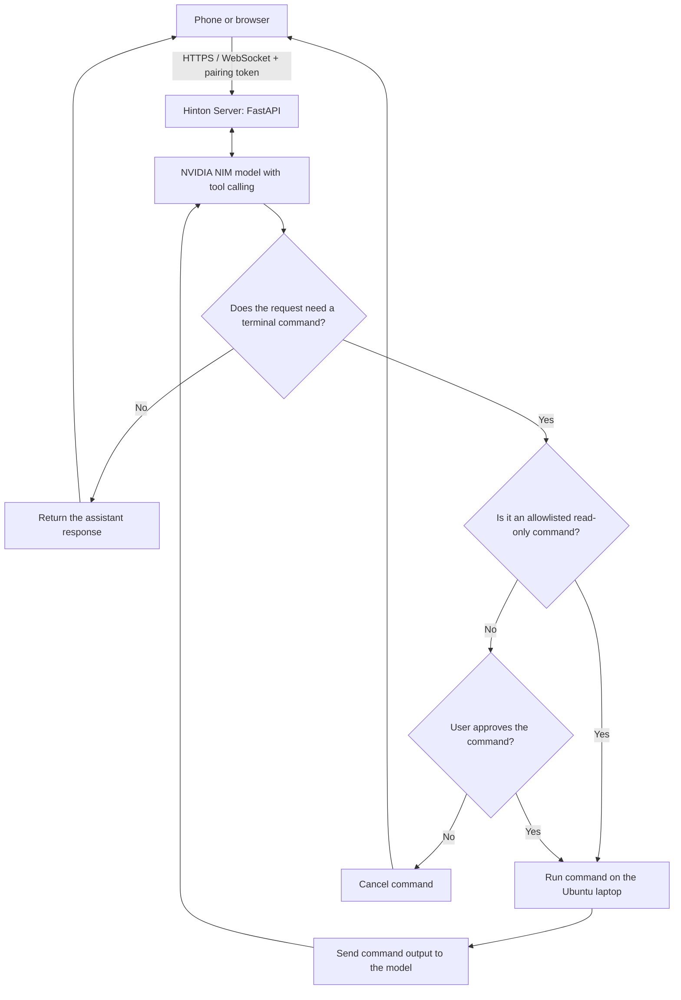

# Hinton Server

Talk to your Ubuntu laptop in plain language. Hinton listens through your phone (or the laptop's browser), thinks with an NVIDIA NIM language model, and can run terminal commands on the laptop for you.

> "What's my disk usage?" "List the files in my Downloads folder." "Create a folder called projects."

Hinton's face is an animated astronaut-robot that blinks, looks around, and moves its mouth while it talks.

This is the **laptop side**. The Android app lives in the [`hinton-app`](https://github.com/HimanshuThakre/hinton-app) repository.

## Architecture



## Features

- **Natural-language terminal control.** Say what you want. The model turns it into a shell command and runs it on the laptop, then summarises the result out loud.
- **Safety first.** Read-only commands (`ls`, `df`, `uptime`, `date`, `free`, ...) run automatically. Anything else makes the face turn amber and asks "Run this command?" You answer by voice ("yes" / "no") or by tapping. Commands containing shell tricks such as `;`, `&&`, `|`, `>` or `$(...)` always ask first.
- **Animated face** in any browser: idle, listening, thinking, talking, and asking-permission states, plus a small round compact mode.
- **Voice in and out** using the browser's built-in speech recognition and speech synthesis (Chrome works best).
- **"Hey Hinton" wake word** (text matching in the browser, accepts near-misses like "Hilton").
- **Pairing token.** Only a device that knows your token can connect.
- **HTTPS** with a self-signed certificate, so the phone's browser allows the microphone.
- **Timeouts.** A slow model never leaves you hanging: requests give up after 40 seconds.

## Roadmap (not built yet)

- **Multi-language answers.** Reply in the language you speak (for example Hindi, Marathi, Tamil), with matching speech recognition and voice. Today the speech engine is set to English (India).
- **Alarms, reminders and timers on the laptop**, set and cancelled by voice (for example with `systemd` timers and desktop notifications).
- **More laptop tools:** open apps, read and write files, play music, volume and brightness.
- **Streaming replies** so Hinton starts talking sooner.
- **Server-side speech** (NVIDIA speech models or Whisper and Piper) for better quality than the browser.

## Requirements

- Ubuntu (other Linux should work), Python 3.10+, `openssl`
- A free NVIDIA API key from <https://build.nvidia.com>
- A phone or computer with Chrome on the same network

## Setup

```bash
sudo apt install -y python3-venv openssl
git clone https://github.com/HimanshuThakre/hinton-server.git
cd hinton-server

export NVIDIA_API_KEY=your-nvidia-key
export PAIR_TOKEN=choose-any-secret-word
export NIM_MODEL=nvidia/nemotron-3.5-lightning-30b-a3b
bash run.sh
```

`run.sh` creates its own virtual environment, makes a certificate the first time, and prints a link such as:

```
https://10.0.0.5:8000/?token=choose-any-secret-word
```

Open that link in Chrome on your phone (same Wi-Fi, or the phone's hotspot). Accept the certificate warning once, allow the microphone, and tap the face or **Start listening**.

If a firewall is on: `sudo ufw allow 8000/tcp`.

### Keeping your secrets out of Git

Never write your key or token into a file in this repository. Put them in a file outside it:

```bash
cat > ~/.hinton_secrets <<'EOF'
export NVIDIA_API_KEY=your-nvidia-key
export PAIR_TOKEN=choose-any-secret-word
EOF
chmod 600 ~/.hinton_secrets
```

Then start with `source ~/.hinton_secrets && bash run.sh`. The included `.gitignore` already excludes `*.pem`, `.env`, `start.sh` and the virtual environment.

## Configuration

| Variable | Default | Meaning |
|---|---|---|
| `NVIDIA_API_KEY` | required | Your NVIDIA API key |
| `PAIR_TOKEN` | `changeme` | Shared secret the phone must present. **Change it.** |
| `NIM_MODEL` | `meta/llama-3.1-70b-instruct` | Model ID. That default has been retired by NVIDIA; set it to a model that works for you (see below) |
| `WORKDIR` | `~` | Folder commands run in |

### Choosing a model

NVIDIA's model list changes. The hosted catalog also lists models that are not currently served, so test before you rely on one:

```bash
curl -s https://integrate.api.nvidia.com/v1/chat/completions \
  -H "Authorization: Bearer $NVIDIA_API_KEY" -H "Content-Type: application/json" \
  -d '{"model":"MODEL-ID","messages":[{"role":"user","content":"hi"}],"max_tokens":20}'
```

A reply containing `"choices"` means it works. The model must support **tool calling** for terminal commands to work. If it only chats, Hinton will talk but never run anything.

## Try saying

- "What's my disk usage?"
- "How much memory is free?"
- "List the files in my home folder."
- "Create a folder called test." (asks for confirmation)

## Security notes

- This gives a voice-controlled model a shell on your laptop. Treat it that way.
- Use a long, unique `PAIR_TOKEN`, and only run the server on networks you trust.
- Do not expose port 8000 to the internet. For use away from home, put the laptop and phone on a private network such as Tailscale.
- Review the confirmation prompts. The allowlist lives in `SAFE_COMMANDS` in `server.py`; shorten it if you want more prompts.
- A misheard word or a confused model can propose a harmful command. That is why only a small read-only set runs without asking.

## Troubleshooting

| Problem | Fix |
|---|---|
| `bad token` or endless 403 lines | Open the link with `?token=...`. Close old tabs that retry with an empty token. |
| `Error code: 404` or `410` | That model is not served. Pick another and set `NIM_MODEL`. |
| `500` in curl tests | Your `NVIDIA_API_KEY` is not set in that terminal. |
| Face loads but never answers | The model may be slow or reasoning for a long time. Try another model; requests time out after 40 s. |
| Microphone blocked | Chrome needs HTTPS (use the link `run.sh` prints) and microphone permission for the site. |
| Phone cannot reach the laptop | Same Wi-Fi? Firewall? Check the address with `hostname -I`; it changes between networks. |

## Files

| File | Purpose |
|---|---|
| `server.py` | FastAPI server, WebSocket, model calls, terminal tool |
| `index.html` | The animated face and voice interface |
| `run.sh` | One-step launcher (virtual environment, certificate, server) |
| `requirements.txt` | Python dependencies |

## License

Add a license of your choice (for example MIT) before sharing publicly.
